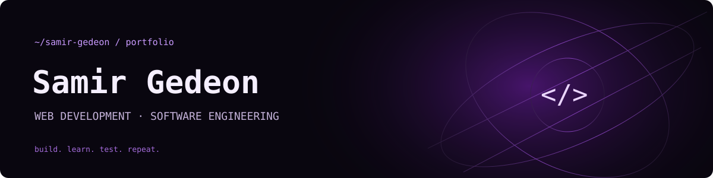

  
  
<code>&gt;_ Software Engineering student · Aspiring Full Stack Developer</code>

  
  

 

### About me

I study **Software Engineering at Universidade de Vassouras** and work in **IT at the City of Miguel Pereira**, Rio de Janeiro. I build web interfaces and APIs to practice backend development, testing and software design.

I am working toward a **junior full stack development opportunity**, with a focus on readable code, useful documentation and reliable applications.

 

### Technologies

  

 

### Statistics

  <picture>
    <source media="(prefers-color-scheme: dark)" srcset="dark_mode.svg" />
    <source media="(prefers-color-scheme: light)" srcset="light_mode.svg" />
    
  </picture>

Real public data, refreshed daily. Language bytes describe code composition, not proficiency. <a href="docs/SETUP.md">Metric definitions and limitations.</a>

 

### Selected projects

| Project | What it demonstrates | Technologies |
| --- | --- | --- |
| [Mania de Bicho](https://github.com/SamirGedeon/mania-de-bicho-site) | Pet-shop prototype with product categories, product pages and a shopping cart persisted in the browser. | React, TypeScript, Tailwind CSS, Vinext |
| [Hotel Fazenda Fascinação](https://github.com/SamirGedeon/hotel-fazenda-fascinacao) | Hospitality website with a component-based interface and responsive styling. | React, TypeScript, Tailwind CSS, Vinext |
| [Inventory manager](https://github.com/SamirGedeon/estoque-spring-api) | Web dashboard and REST API with input validation, H2 persistence and automated tests. | Java, Spring Boot, JDBC, H2 |
| [Automated GitHub profile](https://github.com/SamirGedeon/SamirGedeon) | Public API data collection, theme-aware SVG generation, cached fallback and daily CI automation. | Python, GitHub API, SVG, GitHub Actions |

The pet-shop project is a prototype without checkout or payment processing. The inventory manager is a local learning application. Each repository documents its own setup and limitations.

More projects and software design studies

- [Drew Studio](https://github.com/SamirGedeon/Lading-Page) — responsive interfaces and theme switching with HTML, CSS and JavaScript.
- [Fruta](https://github.com/SamirGedeon/Site-Refri) — product carousel and keyboard navigation with HTML, CSS and JavaScript.
- [Game catalog](https://github.com/SamirGedeon/catalogo-jogos-api) — backend development with Python and Django.
- [Design patterns](https://github.com/SamirGedeon/integracao-chain-strategy-template-method-java) — Chain of Responsibility, Strategy and Template Method with Java, Maven and JUnit.

 

Contribution snake

<picture>
  <source media="(prefers-color-scheme: dark)" srcset="https://raw.githubusercontent.com/SamirGedeon/SamirGedeon/output/github-contribution-grid-snake-dark.svg" />
  
</picture>

  

